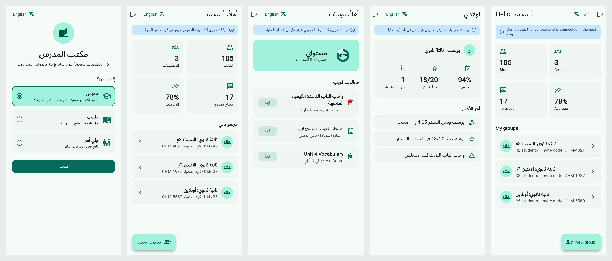

# مكتب المدرس (اسم مؤقت), Teacher Desk

تطبيق Flutter واحد ينزل على **Android و iOS** للمدرسين والطلبة وأولياء الأمور، عربي وإنجليزي.



## الوثائق
- [وثيقة المتطلبات](docs/01-PRD.md)
- [التصميم التقني وقاعدة البيانات](docs/02-ARCHITECTURE.md)
- [خطة التنفيذ](docs/03-ROADMAP.md)

## التشغيل (للمبرمج)
```bash
flutter pub get
flutter gen-l10n
flutter run            # على موبايل أو محاكي متوصل
flutter test           # الاختبارات
flutter analyze        # فحص الكود
```

## الهيكل
- `lib/core/`: اللغة والثيم والتنقل والعناصر المشتركة.
- `lib/features/`: كل جزء لوحده (auth، teacher، student، parent).
- ملفات الترجمة: `lib/core/l10n/app_ar.arb` و `app_en.arb`.

> البيانات اللي في الشاشات دلوقتي **تجريبية**، والسيرفر الحقيقي (Supabase) هيتوصل في الخطوة 4.
